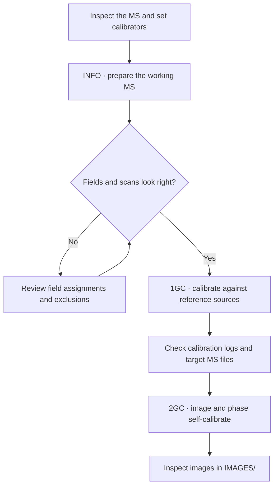

# Running POLKAT on OzSTAR

Here’s how I take one MeerKAT Measurement Set (MS) from raw visibilities to a self-calibrated image with `polkat-0.2.5.sif`. The paths below are for my L_4 observation. For your dataset, change `WORK`, `MS_SOURCE`, and the `cd` line in the 1GC script.



## 1. Set up your observation

For a fresh run, clone POLKAT into an empty working directory. If you already have a checkout and a linked MS, set the variables below, enter `WORK`, and skip the `git clone` and `ln -s` lines.

```bash
WORK=/fred/oz341/skavya/FRB20121102A_kavya/Imaging/L/L_4/working_dir
MS_SOURCE=/fred/oz341/path/to/observation.ms   # Set this to your MS
SIF=/fred/oz341/skavya/scripts/containers/polkat-0.2.5.sif
MS=$(basename "$MS_SOURCE")

mkdir -p "$WORK"
cd "$WORK"
git clone https://github.com/Kavya-7217/polkat.git .
ln -s "$MS_SOURCE" .
git rev-parse HEAD
```

Keep one input `*.ms` here because INFO takes the first match. Run the remaining commands from `WORK`, where POLKAT can find `oxkat/` and `tools/`. If the MS lives outside `/fred`, make sure the compute node can read it and include its filesystem in the container binds.

## 2. Get to know your MS

```bash
module load singularity
singularity exec --bind /fred:/fred "$SIF" python3 tools/ms_info.py "$MS"
nano oxkat/config.py
```

Check the field names, scan intents, band, and channel count. In `oxkat/config.py`, set the container location and bind path.

```python
NODE_CONTAINER_PATH = ['/fred/oz341/skavya/scripts/containers/', CWD]
BIND = '/fred:/fred'
```

Copy the polarisation-angle calibrator’s exact field name into `POLANG_NAME` and set `POLANG_DIR` in the CASA format used in the file. For 3C286 or 3C138, start with the matching example and check `POLANG_MOD` and `XF_TARGET_POLANG`. Keep the checkout commit and container filename with your run notes.

## 3. Run INFO

Each setup command writes a shell script. Submit its Slurm wrapper from `WORK` so the generated commands run on a compute node. Wait for each job to finish and check its results before starting the next one.

```bash
singularity exec --bind /fred:/fred "$SIF" python3 setups/0_GET_INFO.py node
less submit_info_job.sh
```

Save this as `run_info.slurm` in `WORK`.

```bash
#!/bin/bash
#SBATCH --job-name=polkat_info
#SBATCH --ntasks=1
#SBATCH --cpus-per-task=16
#SBATCH --mem=240G
#SBATCH --time=10:00:00
#SBATCH --output=polkat_info_%j.out
#SBATCH --error=polkat_info_%j.err

module load singularity
cd "$SLURM_SUBMIT_DIR"
unset LD_PRELOAD
export OMP_NUM_THREADS=$SLURM_CPUS_PER_TASK

bash -eo pipefail submit_info_job.sh
```

```bash
sbatch run_info.slurm
```

**After INFO**, open `less project_info.json`. Match the master and working MS, targets, calibrators, band, and channel count to your MS inspection. Review excluded scans, especially for 2-second integrations where the short-scan workaround can affect science scans.

## 4. Run referenced calibration (1GC)

```bash
singularity exec --bind /fred:/fred "$SIF" python3 setups/1GC.py node
less submit_1GC_jobs.sh
```

Save this as `run_1GC.slurm` in `WORK`.

```bash
#!/bin/bash
#SBATCH --job-name=polkat_1GC
#SBATCH --ntasks=1
#SBATCH --cpus-per-task=16
#SBATCH --mem=400G
#SBATCH --time=23:59:59
#SBATCH --output=polkat_1GC_%j.out
#SBATCH --error=polkat_1GC_%j.err

module load singularity
cd /fred/oz341/skavya/FRB20121102A_kavya/Imaging/L/L_4/working_dir/
unset LD_PRELOAD
export OMP_NUM_THREADS=$SLURM_CPUS_PER_TASK

bash -eo pipefail submit_1GC_jobs.sh
```

```bash
sbatch run_1GC.slurm
```

**After 1GC**, review `LOGS/` for calibration failures and check that the target MS files listed in `project_info.json` exist.

## 5. Image and phase self-calibrate (2GC)

```bash
singularity exec --bind /fred:/fred "$SIF" python3 setups/2GC.py node
less submit_2GC_jobs.sh
```

Save this as `run_2GC.slurm` in `WORK`.

```bash
#!/bin/bash
#SBATCH --job-name=polkat_2GC
#SBATCH --ntasks=1
#SBATCH --cpus-per-task=16
#SBATCH --mem=240G
#SBATCH --time=1-00:00:00
#SBATCH --output=polkat_2GC_%j.out
#SBATCH --error=polkat_2GC_%j.err

module load singularity
cd "$SLURM_SUBMIT_DIR"
unset LD_PRELOAD
export OMP_NUM_THREADS=$SLURM_CPUS_PER_TASK

bash -eo pipefail submit_2GC_jobs.sh
```

```bash
sbatch run_2GC.slurm
```

**After 2GC**, open `IMAGES/` to inspect the target images. The individual imaging and self-calibration logs are in `LOGS/`.

## Follow a job

Use the ID printed by `sbatch`. For example, to follow 1GC from `WORK`, run

```bash
JOBID=12345678   # Replace with your job ID
squeue -j "$JOBID"
tail -f "polkat_1GC_${JOBID}.out"
```

Press `Ctrl+C` to leave the live log. Once the job finishes, check its final state and exit code.

```bash
sacct -j "$JOBID" --format=JobID,State,ExitCode,Elapsed
```

Look for `COMPLETED` and `0:0`. If a step fails, start with `polkat_1GC_<jobid>.err` and the matching step log in `LOGS/`. For INFO or 2GC, use `polkat_info` or `polkat_2GC` in the log filename.
