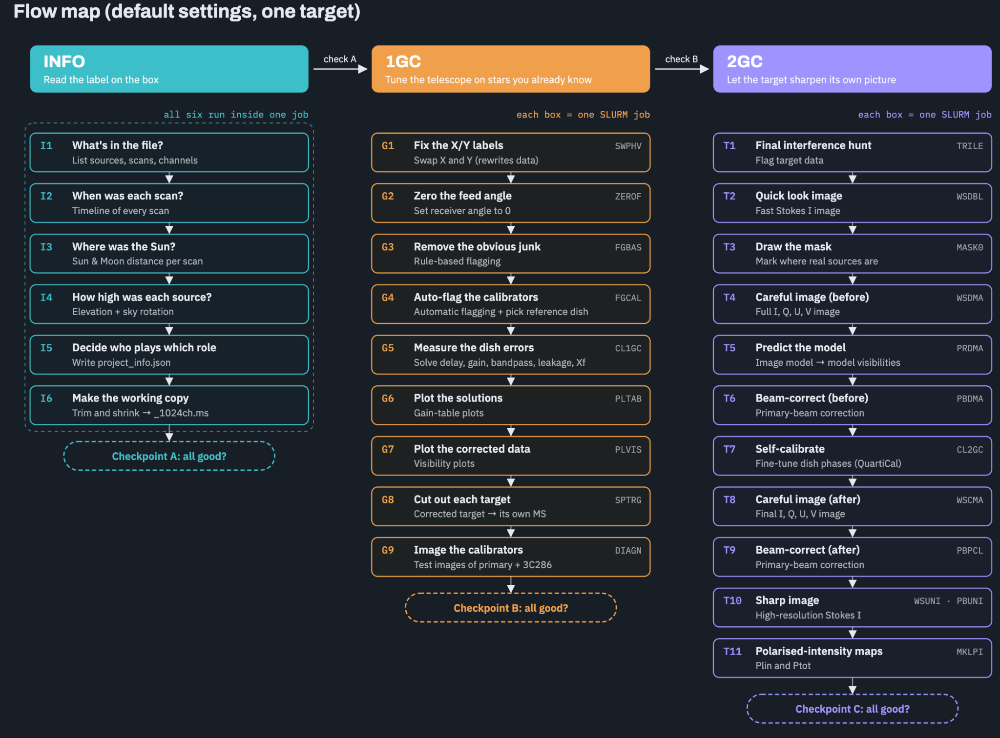

# Running POLKAT on OzSTAR

Andrew K. Hughes, Fraser J. Cowie, Ian Heywood, and Ben Hugo developed [POLKAT](https://github.com/AKHughes1994/polkat) for calibrating and imaging MeerKAT polarisation data. These are my instructions for running their pipeline on OzSTAR.

Here’s how I take one MeerKAT Measurement Set (MS) from raw visibilities to a self-calibrated image with `polkat-0.2.5.sif`. The paths below are for one of my R1 observation. For your dataset, change `WORK`, `MS_SOURCE`, and the `cd` line in the 1GC script.

[](assets/polkat-flow-map.png)

Click the map to zoom in. In this OzSTAR setup, each Slurm wrapper runs the steps for one stage in a single allocation.

## 1. Set up your observation

For a fresh run, clone POLKAT into an empty working directory. If you already have a checkout and a linked MS, set the variables below, enter `WORK`, and skip the `git clone` and `ln -s` lines.

```bash
WORK=/fred/oz341/skavya/FRB20121102A_kavya/Imaging/L/L_4/working_dir
MS_SOURCE=/fred/oz341/path/to/observation.ms   # Set this to your MS
SIF=/fred/oz341/skavya/scripts/containers/polkat-0.2.5.sif
MS=$(basename "$MS_SOURCE")

mkdir -p "$WORK"
cd "$WORK"
git clone https://github.com/Kavya-7217/polkat.git .
ln -s "$MS_SOURCE" .
git rev-parse HEAD
```

Keep one input `*.ms` here because INFO takes the first match. Run the remaining commands from `WORK`, where POLKAT can find `oxkat/` and `tools/`. If the MS lives outside `/fred`, make sure the compute node can read it and include its filesystem in the container binds.

## 2. Get to know your MS

```bash
module load singularity
singularity exec --bind /fred:/fred "$SIF" python3 tools/ms_info.py "$MS"
nano oxkat/config.py
```

Check the field names, scan intents, band, and channel count. In `oxkat/config.py`, set the container location and bind path.

```python
NODE_CONTAINER_PATH = ['/fred/oz341/skavya/scripts/containers/', CWD]
BIND = '/fred:/fred'
```

Copy the polarisation-angle calibrator’s exact field name into `POLANG_NAME` and set `POLANG_DIR` in the CASA format used in the file. For 3C286 or 3C138, start with the matching example and check `POLANG_MOD` and `XF_TARGET_POLANG`. Keep the checkout commit and container filename with your run notes.

## 3. Run INFO

Each setup command writes a shell script. Submit its Slurm wrapper from `WORK` so the generated commands run on a compute node. Wait for each job to finish and check its results before starting the next one.

```bash
singularity exec --bind /fred:/fred "$SIF" python3 setups/0_GET_INFO.py node
less submit_info_job.sh
```

Save this as `run_info.slurm` in `WORK`.

```bash
#!/bin/bash
#SBATCH --job-name=polkat_info
#SBATCH --ntasks=1
#SBATCH --cpus-per-task=16
#SBATCH --mem=240G
#SBATCH --time=10:00:00
#SBATCH --output=polkat_info_%j.out
#SBATCH --error=polkat_info_%j.err

module load singularity
cd "$SLURM_SUBMIT_DIR"
unset LD_PRELOAD
export OMP_NUM_THREADS=$SLURM_CPUS_PER_TASK

bash -eo pipefail submit_info_job.sh
```

```bash
sbatch run_info.slurm
```

### Checks after INFO

Slurm can report `COMPLETED` even when a POLKAT step failed and the script carried on. After **every stage**, run this from `WORK`. Open each file listed and read the lines around the match.

```bash
grep -ilE "traceback|severe|error|killed|oom" casa-*.log
```

Open `less project_info.json` and check the master and working MS paths, then check these fields.

| Field | What to look for |
| --- | --- |
| `band` | Matches the observation. |
| `primary_tag` | `1934` or `0408`. Investigate an `other` tag. |
| `polang_name` | Contains the angle calibrator’s field name. An empty value skips polarisation calibration. |
| `target_cal_map` | Each target is paired with its expected phase calibrator. |

Inspect the working copy inside the container. Use its exact name from `project_info.json`.

```bash
WORK_MS=observation_1024ch.ms   # Replace with your working MS
singularity exec --bind /fred:/fred "$SIF" python3 tools/ms_info.py "$WORK_MS"
```

Compare with the original MS inspection. Expect **1024 channels**, every required source, and only single-integration glitch scans among the dropped scans.

## 4. Run referenced calibration (1GC)

> [!IMPORTANT]
> **Never run 1GC twice on the same `_1024ch.ms`.** It swaps the X/Y feeds in place. To redo 1GC, remove only the generated working copy, keep the original MS, and rerun INFO to build a fresh copy first.

```bash
singularity exec --bind /fred:/fred "$SIF" python3 setups/1GC.py node
less submit_1GC_jobs.sh
```

Save this as `run_1GC.slurm` in `WORK`.

```bash
#!/bin/bash
#SBATCH --job-name=polkat_1GC
#SBATCH --ntasks=1
#SBATCH --cpus-per-task=16
#SBATCH --mem=400G
#SBATCH --time=23:59:59
#SBATCH --output=polkat_1GC_%j.out
#SBATCH --error=polkat_1GC_%j.err

module load singularity
cd /fred/oz341/skavya/FRB20121102A_kavya/Imaging/L/L_4/working_dir/
unset LD_PRELOAD
export OMP_NUM_THREADS=$SLURM_CPUS_PER_TASK

bash -eo pipefail submit_1GC_jobs.sh
```

```bash
sbatch run_1GC.slurm
```

### Checks after 1GC

```bash
grep -ilE "traceback|severe|error|killed|oom" casa-*.log
grep "Flux density for" casa-*.log
```

- **Logs and flux scale.** Read around any error matches. Compare each phase calibrator’s fitted flux density with its catalogue value at the observing frequency. Look for close agreement and a small fit uncertainty.
- **Gain solutions.** Open `GAINPLOTS/`. Check that all expected dishes have solutions, the delay (K) and bandpass (B) plots look smooth, and gaps fall in known interference bands.
- **Target files.** Check that the target MS files listed in `project_info.json` exist.

Open the calibrator images matching `IMAGES/*diagnostic*-MFS-{I,Q,U,V}-image.fits`. Compare the polarisation at the source position with the catalogue for your band. These are approximate L-band checks.

| Calibrator | What to look for |
| --- | --- |
| Primary (1934 or 0408) | Q, U and V consistent with zero within the image noise. |
| 3C286 | About 9–10% linear polarisation at a position angle of about +33°. |
| 3C138 | About 5–6% at about −14°. Allow for variability when comparing with the catalogue. |

**If these checks fail, stop before 2GC.** Resolve the 1GC calibration first. Target phase self-calibration cannot repair a bad reference calibration.

## 5. Image and phase self-calibrate (2GC)

```bash
singularity exec --bind /fred:/fred "$SIF" python3 setups/2GC.py node
less submit_2GC_jobs.sh
```

Save this as `run_2GC.slurm` in `WORK`.

```bash
#!/bin/bash
#SBATCH --job-name=polkat_2GC
#SBATCH --ntasks=1
#SBATCH --cpus-per-task=16
#SBATCH --mem=240G
#SBATCH --time=1-00:00:00
#SBATCH --output=polkat_2GC_%j.out
#SBATCH --error=polkat_2GC_%j.err

module load singularity
cd "$SLURM_SUBMIT_DIR"
unset LD_PRELOAD
export OMP_NUM_THREADS=$SLURM_CPUS_PER_TASK

bash -eo pipefail submit_2GC_jobs.sh
```

```bash
sbatch run_2GC.slurm
```

### Checks after 2GC

```bash
grep -ilE "traceback|severe|error|killed|oom" casa-*.log
grep -l "Final post-solve chi-squared summary" LOGS/2GC_*/*
```

- **Logs and solver.** Read around any CASA error matches. Look for a final QuartiCal summary for each target in this run. If it is missing, treat that solve as unfinished until you inspect the full log. Read the summary itself to assess convergence.
- **Flagging.** Check `LOGS/slurm_TRILE*.log` for the *additional* fraction flagged by Tricolour. As a guide, expect less than about 10–15% extra flagging. Investigate larger increases.
- **Mask.** Overlay `*datablind*mask.fits` on the quick Stokes I image in `IMAGES/`. The mask should outline real sources and leave out rings and stripes.

**Did self-cal help?** The quick `datablind` image identifies sources for the mask. POLKAT then cleans the 1GC data inside that mask to make `datamask` and predicts model visibilities from the cleaned model. QuartiCal compares the data with those visibilities to solve for each dish’s phase. The same masked imaging step on the corrected data gives `pcalmask`.

Compare `datamask` (before) and `pcalmask` (after) for the same target and band.

| Check | What you want to see in `pcalmask` |
| --- | --- |
| Noise | Equal or lower rms in the same source-free region. |
| Artefacts | Weaker rings and stripes around bright sources on the same display scale. |
| Target flux density | Agreement within a few per cent, allowing for measurement uncertainty. A significant drop can indicate flux suppression during self-cal. Revisit the model and mask. |

## Follow a job

Use the ID printed by `sbatch`. For example, to follow 1GC from `WORK`, run

```bash
JOBID=12345678   # Replace with your job ID
squeue -j "$JOBID"
tail -f "polkat_1GC_${JOBID}.out"
```

Press `Ctrl+C` to leave the live log. Once the job finishes, check its final state and exit code.

```bash
sacct -j "$JOBID" --format=JobID,State,ExitCode,Elapsed
```

Look for `COMPLETED` and `0:0`. If a step fails, start with `polkat_1GC_<jobid>.err` and the matching step log in `LOGS/`. For INFO or 2GC, use `polkat_info` or `polkat_2GC` in the log filename.
